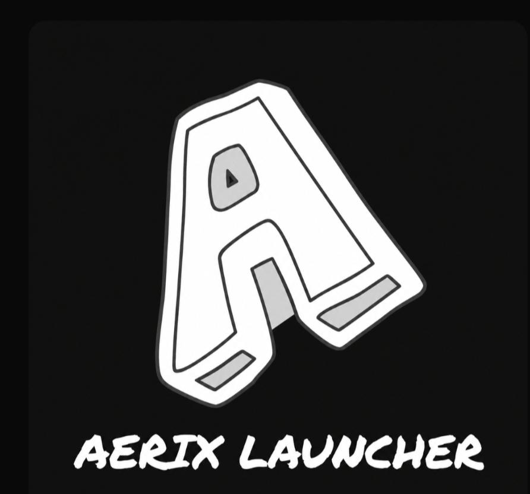
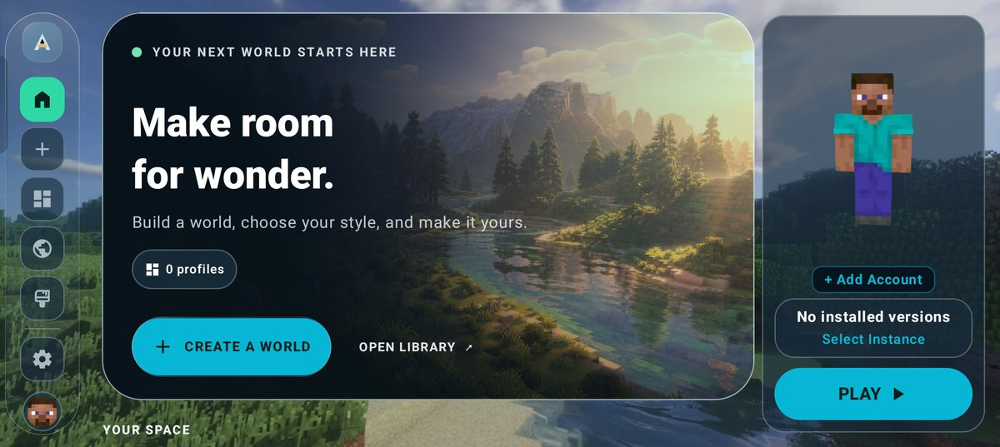
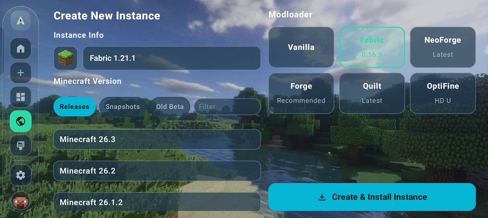
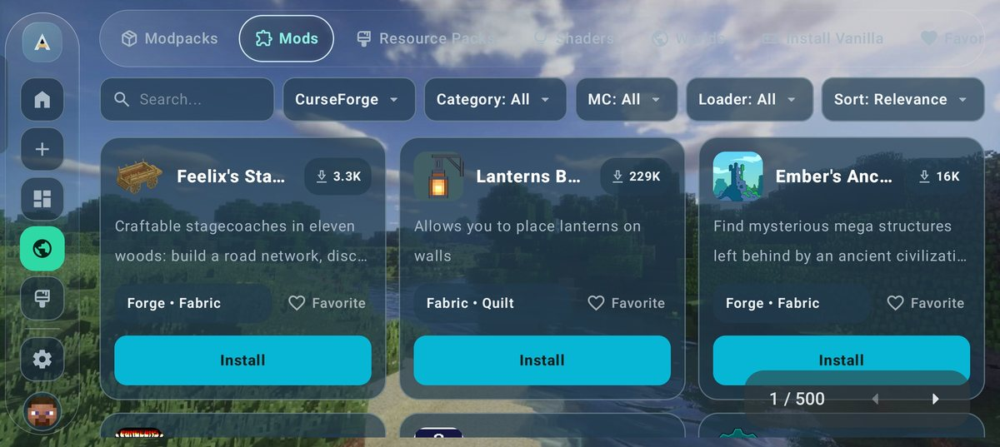
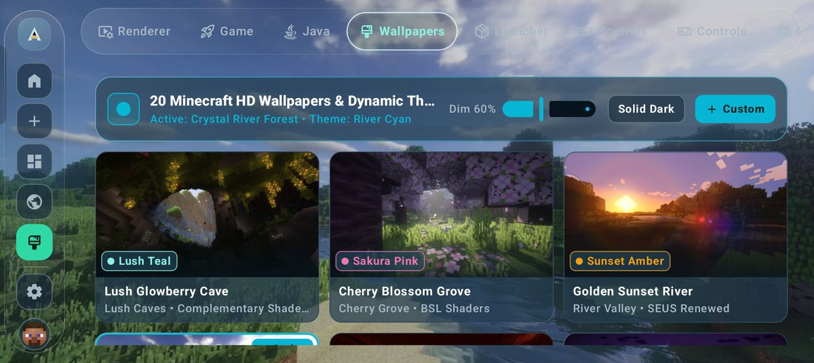
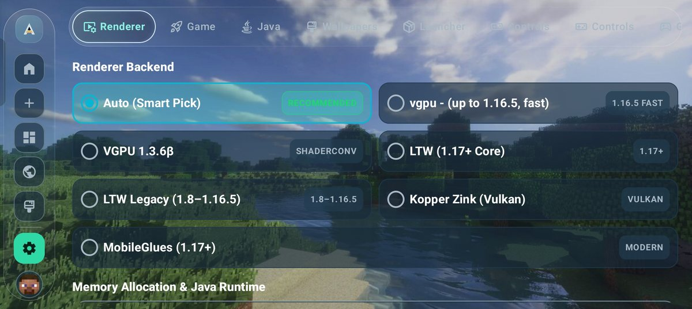
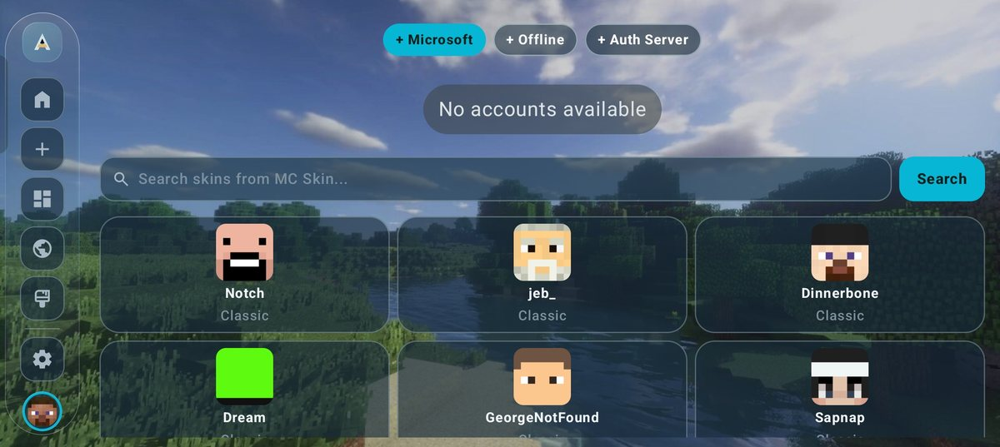

# Aerix Launcher — Minecraft: Java Edition on Android

  

  <strong>✨ 🚀 AERIX LAUNCHER</strong> 
  <em>Minecraft: Java Edition on Android</em> 
  Hand-built. Privately kept. Tested on real phones. Maintained by its owner.

  
  
  
  
  
  
  

  <strong>LIVE FROM GITHUB — updated by GitHub, not by hand</strong>

  
  
  
  

***

> ⚠️ **CRITICAL PROJECT REBOOT NOTICE (READ FIRST)**  
> The legacy codebase of Aerix Launcher was completely discontinued and deleted by the developer due to unfixable internal architectural bugs. **This repository represents a completely fresh, optimized, written-from-scratch codebase.** Any historical download pages, third-party mirrors (such as old Appteka links), or legacy forks referencing old builds are completely obsolete and broken. **This is the single official, live, and actively maintained repository for Aerix Launcher.**

***

## 🗺️ Quick Links

  <strong>
    <a href="#-install">▶ Play</a> &nbsp;·&nbsp; 
    <a href="#-discover">🔍 Discover</a> &nbsp;·&nbsp; 
    <a href="#%EF%B8%8F-settings">⚙️ Settings</a> &nbsp;·&nbsp; 
    <a href="#-accounts-skins-and-capes">👤 Offline Accounts & Capes</a> &nbsp;·&nbsp; 
    <a href="#%EF%B8%8F-private-on-purpose">🔒 Private by Design</a>
  </strong>

## 📸 Screenshots

**Home (No Top Bar):** The page starts cleanly at the very top of your mobile screen, keeping *Create a World*, *Open Library*, and *PLAY* exactly one touch away.  

**Create New Instance:** The Minecraft version list takes over the left column (with the selected version clearly outlined by a check mark), flanked beautifully by a responsive modloader grid.  

**Discover:** Fully integrated window to browse and natively install mods, modpacks, shaders, and resource packs with modular filters for platform, category, game version, and loader framework.  

**Wallpapers:** 25 built-in, HD custom Minecraft wallpapers—each housing its own tailored accent theme, dim controls, and support for external user imports.  

**Renderers:** Pick your renderer, Vulkan driver configuration, and graphics API per-version, backed by a smart, automated recommended default template.  

**Accounts & Skins:** Authenticate Microsoft, offline, or external auth-server accounts in tandem with a searchable three-column skin library featuring one-tap installations.  

---

## 🏆 Why Aerix?
Aerix Launcher brings Minecraft: Java Edition instances, renderers, accounts, and optimization tools neatly together under a single native Android client. 

This is **not** a generic, automated app template. This is **not** a bloated team product with commercial analytics trackers bolted onto the side. It is a well-developed, frequently optimized launcher written and deeply tested by its sole owner on multiple physical test phones to ensure that the code which ships is the code that actually runs fluidly in your hands.

> ✨ **One Developer. Zero AI-generation. Real-device verified. Private by default.**

---

## ⚙️ Tools For Your Setup
Aerix natively organizes launcher layouts, renderer stacks, and instance folders inside one clean workspace.

*   **⚡ Quick Access:** Your most recently launched singleplayer worlds and instances stay right on the main dashboard.
*   **🧩 Serious Render Stack:** Pick the exact engine that maps to your SoC. LTW and LTW Legacy are built completely from source in this repository (covering Minecraft 1.17+ and 1.8–1.16.5 respectively), alongside GL4ES, VirGL, Zink-class (Vulkan), and Mesa architectures. Aerix also bundles MobileGlues for 1.17+, dual VGPU parameters for 1.16.5 and older, and automatically configures the best default renderer on boot.
*   **🧮 Smart RAM Allocation:** A global memory allocation slider paired with per-instance overrides for running dense modpacks.
*   **📱 Universal UI Pass:** Responsive UI scaling, menu layouts, skins, and launch hooks are verified across multiple device displays.
*   **🛠️ Agile Deployment:** Polish passes and bug fixes land regularly, with an open automated check hook mapping straight to the GitHub Releases API.

---

## 🛡️ Private. On Purpose.
Aerix respects user privacy. Your worlds are yours. Your accounts are yours. Aerix does not take a cut or a look at either.

*   🚫 **No Ads:** No popups, banners, or monetization layers.
*   🚫 **No Telemetry:** Zero analytics trackers, hidden logs, or user reporting data streams.
*   🚫 **No Harvesting:** No profiling, credential logging, or account caching.
*   🔒 **Local-First Security:** Profiles, custom skins, and capes remain strictly isolated on your device storage unless you deliberately initiate a login that explicitly requests a remote server connection.
*   📦 **GPL-3.0 Verification:** Fully open-source code so the internal application mechanics are completely inspectable by anyone.

---

## 👤 Accounts, Skins, and Capes
*   **👤 Offline Profiles:** Create an instantaneous local username without region restrictions or network locks. 
*   **👕 Skin Customization:** Equip any standard Java format skin onto offline accounts.
*   **🧥 Cape Customization:** Full companion support for rendering local capes on local offline profiles.
*   **🌐 Microsoft Integration:** Secure OAuth login endpoints for native Java Edition accounts that legitimately own the game.
*   **🔑 Yggdrasil Support:** Native integration for authenticating against alternative third-party login/auth servers.
*   **🖼️ 3D Previews:** Includes a fully animated 3D skin viewer so you can check your character cosmetics before spinning up the Java engine.

---

## 📋 Full Feature List

### ▶ Play
*   Unified Play hub linking your file path library and recent worlds together.
*   Instantly boot, tweak, duplicate, delete, and manage local directory instances.
*   Personalize profiles using specialized instance icons (colors, symbols, or emojis).
*   Sort directory structures using instance groups to segregate survival worlds from pack directories.
*   Seamless manual version installations alongside individual game adjustments.

### 🔍 Discover
*   Browse and install modpacks, standalone mods, resource packs, shaders, and custom maps.
*   Sift through databases using full text searching, strict categories, and item favorites.
*   Intelligent target down-patching: assets land directly into their corresponding instance directories rather than a generic downloads folder.

### ⚙️ Settings
*   Full Material You / Material 3 interface integration supporting automatic light and dark styling matching your Android OS theme.
*   Granular accent and background theme coloring controls.
*   Direct version-by-version engine adjustments.
*   Global memory sliders alongside discrete system profiling tools.
*   Multi-language file maps.
*   Clean about documentation confirming project ownership under **entitybrian**.
*   Direct version updates using a strict GitHub Releases API lookup.

### 🎮 In-Game Controls & System Utilities
*   Modular touch control canvas editor allowing you to draft, position, and scale fully customized buttons and layouts.
*   Native physical gamepad translation and controller remapping parameters.
*   Integrated high-level file browser allowing users to tweak configurations, drop mods, move worlds, or run data backups directly inside the application.
*   Per-instance multiplayer server tables supporting instant-connect shortcuts.
*   Real-time system log output terminal for checking runtime exceptions or crash dumps.
*   Direct zip/archive modpack imports.
*   Uncompromised credit matrices—nothing is obscured to force an artificial "minimalist" appearance.

---

## 🛡️ Quality Bar
*   **100% Human-Coded:** Pure handcrafted layout structure. No automated wrappers, no AI passes filling in layouts, and no generated scrap.
*   **Owner Maintained:** The person who writes the modules is the person tracking issues, fixing dependencies, and addressing community reports.
*   **Multi-Device Validation:** Built builds are rigorously evaluated on a cluster of different hardware configurations before moving into stable branches.
*   **Continuous Debugging:** Automated Debug CI compiles on every commit and incoming pull request to safeguard against silent deployment breaks.

---

## 🧰 Aerix at a Glance
Aerix consolidates instance optimization, engine selection, profile customization, and in-app asset downloads inside an easy-to-use Android application packaging. Our code is distributed under the GNU General Public License v3.0, and our statements outline real capabilities without making generic, platform-wide marketing performance claims.

---

## 👥 The Team

   
  <strong>entitybrian</strong> 
  Owner · Core Developer · Tester · Maintainer

  
  
  

entitybrian designs, writes, tests, and ships Aerix Launcher.

No studio. No outsourced UI. No AI pass that “fills in the screens.”

That is why the product stays coherent: the people who add offline capes are the people who check them on another phone, and who cut a release when it is actually ready.

---

## 📥 Install

1. Download the latest APK from [Releases](https://github.com/entitybrian69-bit/Aerix-launcher/releases).
2. Allow install from this source in Android settings.
3. Open Aerix, add an offline account or sign in with Microsoft, equip a skin and cape, and play.

**Requires Android 8.0+.** Best on 4 GB RAM or more.

Debug builds from CI are for testing. Release builds are the ones to keep.

🌐 **Website:** <https://entitybrian69-bit.github.io/Aerix-launcher/> — screenshots, the full renderer lineup, a setup guide and an FAQ.

---

## 🔄 Updates

Settings → About → Check for update.

Aerix asks the GitHub Releases API, compares your build, and points you at the newest APK. No mystery JSON. No dead link.

---

## 🤝 Contributing

This is a small project. Help is still welcome.

- ⭐ Star the repo
- 🐛 Open a clear bug report
- 💡 Suggest a feature
- 🌍 Help translate

---

## 💬 Community and suggestions

**Discord channel** — join to talk with other Aerix users, report a problem, and suggest what should land next.

**Invite link:** <https://discord.gg/RS7q9KaCm6>

---

## 📜 License

GPL-3.0. See [LICENSE](LICENSE).

Minecraft is a trademark of Mojang Synergies AB. Aerix Launcher is an independent project and is not affiliated with, endorsed by, or associated with Mojang or Microsoft.

---

### 🎮 Minecraft: Java Edition, in your pocket.

**Configurable renderers. Private by design. Offline accounts and capes. Updated with care.**

🌐 **[Website](https://entitybrian69-bit.github.io/Aerix-launcher/)** · 💬 **[Discord](https://discord.gg/RS7q9KaCm6)** · ⭐ [Star Aerix](https://github.com/entitybrian69-bit/Aerix-launcher) · 📦 [Get the APK](https://github.com/entitybrian69-bit/Aerix-launcher/releases)

